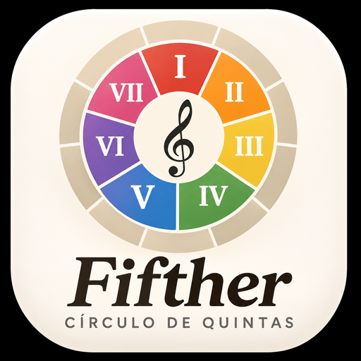

# Fifther

### Círculo de quintas y exploración armónica

**Una aplicación de MusixLab**

[ABRIR FIFTHER](https://edugogo66-arch.github.io/fifthter/)

---

## Presentación

Fifther es una herramienta musical interactiva diseñada
para comprender visualmente las relaciones entre
tonalidades, grados y acordes.

Su filosofía combina rigor musical, sencillez,
interacción y representación cromática.

## Características

- Círculo de quintas interactivo.
- Tonalidades mayores y menores.
- Código cromático permanente para los grados.
- Tonalidades relativas y paralelas.
- Tablas dinámicas de acordes diatónicos.
- Representación de las armaduras.
- Notación castellana y cifrado americano.
- Diseño adaptable a diferentes dispositivos.
- Instalación como aplicación web.
- Funcionamiento sin conexión tras la carga inicial.

## Identidad cromática MusixLab

| Grado | Color | Código |
|---|---|---|
| I | Rojo | #D94B4B |
| II | Naranja | #E99738 |
| III | Amarillo | #E4CA45 |
| IV | Verde | #56A568 |
| V | Azul | #438BD1 |
| VI | Violeta | #9364C9 |
| VII | Rosa | #D36B9D |

El color identifica el grado relativo a la tónica,
no la nota absoluta.

## Hoja de ruta

- [x] Círculo de quintas interactivo.
- [x] Sistema cromático de grados.
- [x] Publicación mediante GitHub Pages.
- [ ] Armaduras simbólicas y relieve visual.
- [ ] Biblioteca de progresiones armónicas.
- [ ] Jazz, blues, rock y pop.
- [ ] Dominantes secundarias.
- [ ] Sustituciones tritonales y backdoor.
- [ ] Canciones de referencia.
- [ ] Reproducción sonora de acordes.
- [ ] Inversiones y conducción de voces.
- [ ] Editor de progresiones propias.

## Historial de versiones

### 1.0
Primera publicación de Fifther.

## Tecnología

HTML5 · CSS · JavaScript · SVG · PWA · GitHub Pages

---

### MusixLab

*Comprender la música a través de la interacción.*

